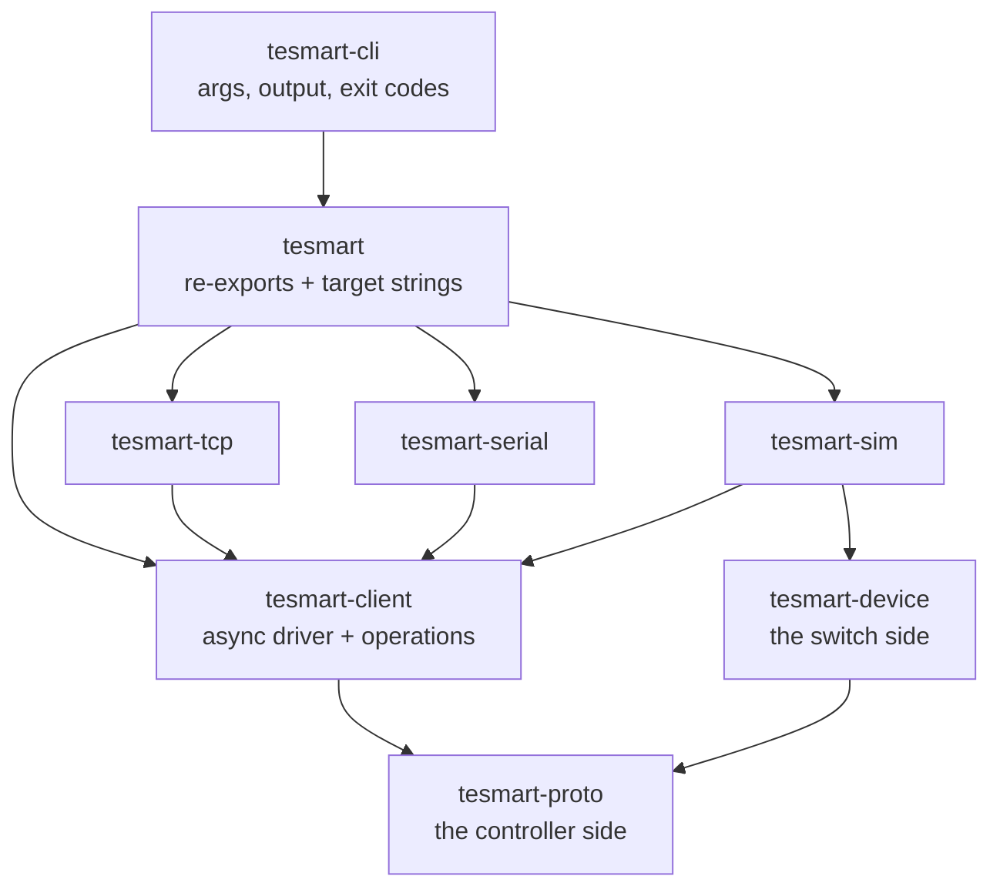

# tesmart-rs: Architecture

How the workspace is layered, and why. For the wire-level details (bytes, opcodes, per-model support), see the companion [TESmart KVM Control Protocol Reference](protocol-reference.md).

## Principles

**Sans-IO at the core.** The protocol is a pure state machine: bytes in, events out, no sockets and no clock. Everything that awaits lives in exactly one crate. This is what makes the hard parts — command spacing, retries, resynchronisation after garbage — testable without hardware, a network, or a running runtime.

**Almost everything is shared.** A protocol family is only an opcode table (data, not code), a codec choice, and a few framing quirks.

**Capabilities belong to the model, not the family.** The family says which commands *exist*; the registry says which ones are believed to *work*, and on what evidence. Within the matrix family alone there are four different command sets.

**Say what was actually established.** The protocol acknowledges almost nothing, so operations return outcomes rather than `()`. "The switch is on port 3" and "port 3 was requested and nobody can confirm it" must stay distinguishable all the way to the user.

## Crates

| Crate | Role | Awaits? | `no_std`? |
| --- | --- | --- | --- |
| `tesmart-proto` | the protocol, **controller** side: codecs, families, registry, engine | no | **yes** |
| `tesmart-device` | the protocol, **switch** side: a state machine that answers like hardware | no | **yes** |
| `tesmart-client` | the async driver and the operations | **yes** | no |
| `tesmart-tcp` | one `Connector` over TCP | yes | no |
| `tesmart-serial` | one `Connector` over RS232 | yes | no |
| `tesmart-sim` | serves a `tesmart-device` behind a `Connector` | yes | no |
| `tesmart` | the library front door: re-exports and target strings | yes | no |
| `tesmart-cli` | the `tesmart` binary | yes | no |

The transport crates contain no protocol or operation code at all: a transport is one trait with one method. Adding RS232 did not change a line of either.

**Both halves of the protocol build for `thumbv7em-none-eabi` in CI**, which is what keeps the sans-IO boundary honest. Neither has an allocator, and `tesmart-proto` has no dependency beyond `thiserror`.

### Why the switch side is its own crate

It was a feature of `tesmart-proto` at first, which was wrong twice over. A feature that gates a thousand lines of self-contained code and removes no dependency is a crate boundary wearing a disguise. And the device side is not only a test double: it is `no_std` with one dependency, so a microcontroller running it answers `AA BB 03 11 XX EE` like the genuine article and software written for TESmart hardware drives it unchanged.

The split costs one thing, worth naming: `MatrixCommand` and `AsciiCommand` are `#[non_exhaustive]`, so `tesmart-device` must end its matches with a wildcard and a command added to `tesmart-proto` will be silently ignored rather than failing to compile. The equivalent guarantee on the controller side is untouched, because `Request` and the profile tables live in one crate together — and that is the one that prevents the `0x03` family clash.
