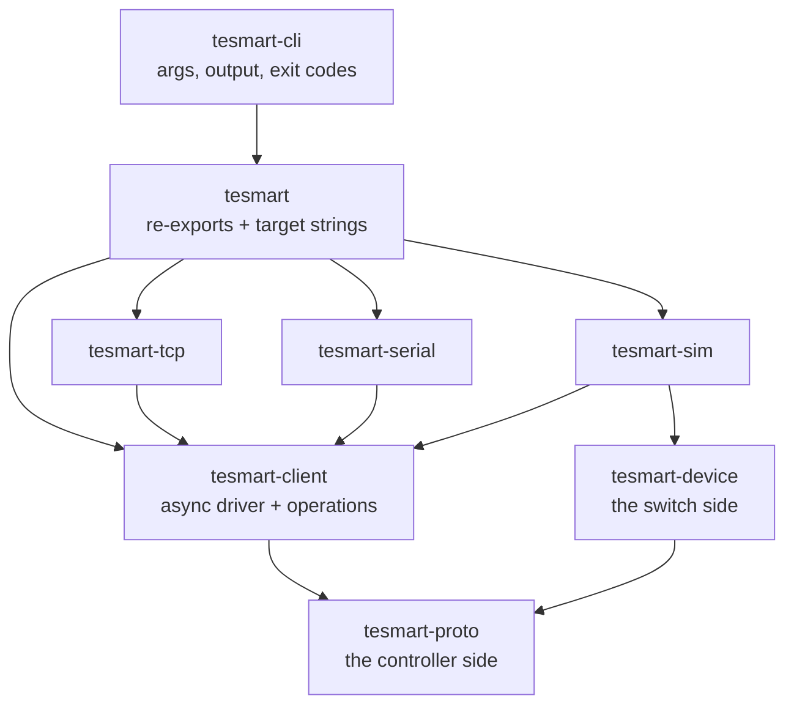

# tesmart-rs: Architecture

How the workspace is layered, and why. For the wire-level details (bytes, opcodes, per-model support), see the companion [TESmart KVM Control Protocol Reference](protocol-reference.md).

## Principles

**Sans-IO at the core.** The protocol is a pure state machine: bytes in, events out, no sockets and no clock. Everything that awaits lives in exactly one crate. This is what makes the hard parts — command spacing, retries, resynchronisation after garbage — testable without hardware, a network, or a running runtime.

**Almost everything is shared.** A protocol family is only an opcode table (data, not code), a codec choice, and a few framing quirks.

**Capabilities belong to the model, not the family.** The family says which commands *exist*; the registry says which ones are believed to *work*, and on what evidence. Within the matrix family alone there are four different command sets.

**Say what was actually established.** The protocol acknowledges almost nothing, so operations return outcomes rather than `()`. "The switch is on port 3" and "port 3 was requested and nobody can confirm it" must stay distinguishable all the way to the user.

## Crates

| Crate | Role | Awaits? | `no_std`? |
| --- | --- | --- | --- |
| `tesmart-proto` | the protocol, **controller** side: codecs, families, registry, engine | no | **yes** |
| `tesmart-device` | the protocol, **switch** side: a state machine that answers like hardware | no | **yes** |
| `tesmart-client` | the async driver and the operations | **yes** | no |
| `tesmart-tcp` | one `Connector` over TCP | yes | no |
| `tesmart-serial` | one `Connector` over RS232 | yes | no |
| `tesmart-sim` | serves a `tesmart-device` behind a `Connector` | yes | no |
| `tesmart` | the library front door: re-exports and target strings | yes | no |
| `tesmart-cli` | the `tesmart` binary | yes | no |

The transport crates contain no protocol or operation code at all: a transport is one trait with one method. Adding RS232 did not change a line of either.

**Both halves of the protocol build for `thumbv7em-none-eabi` in CI**, which is what keeps the sans-IO boundary honest. Neither has an allocator, and `tesmart-proto` has no dependency beyond `thiserror`.

### Why the switch side is its own crate

It was a feature of `tesmart-proto` at first, which was wrong twice over. A feature that gates a thousand lines of self-contained code and removes no dependency is a crate boundary wearing a disguise. And the device side is not only a test double: it is `no_std` with one dependency, so a microcontroller running it answers `AA BB 03 11 XX EE` like the genuine article and software written for TESmart hardware drives it unchanged.

The split costs one thing, worth naming: `MatrixCommand` and `AsciiCommand` are `#[non_exhaustive]`, so `tesmart-device` must end its matches with a wildcard and a command added to `tesmart-proto` will be silently ignored rather than failing to compile. The equivalent guarantee on the controller side is untouched, because `Request` and the profile tables live in one crate together — and that is the one that prevents the `0x03` family clash.

## tesmart-proto, bottom to top

### `port`, `value` — validated arguments

Each setting gets its own type rather than a shared boolean, because the wire values are not consistent: `0x00` means *mute* for the buzzer but *off* for auto input detect, dual-monitor pass-through is inverted, and the matrix buzzer is inverted against the KVM one. Naming each setting keeps those surprises in one place.

`port` owns the **±1 conversion**. Writes are 1-based, the read reply is 0-based; callers always pass and receive the human port number. No other module adds or subtracts 1.

### `wire` — two codecs and a stream decoder

| Module | Content |
| --- | --- |
| `wire::frame` | `AA BB <len> <op> <data…> EE`, with `len = len(data) + 2` |
| `wire::ascii` | the network strings, the matrix strings, and the `LINK:` reply |
| `wire::decode` | `StreamDecoder`: the part that copes with real hardware |

The decoder is the load-bearing piece. The LAN port is a serial-to-Ethernet bridge, so a TCP stream behaves like a serial line: replies split across segments, unsolicited port reports arriving mid-command, terminators that are not `0xEE`, and occasional garbage. It resynchronises rather than failing, and distinguishes a port report from a malformed one from text.

`MAX_WIRE_LEN` is sized for the largest *logical* unit (88 bytes, a 16x16 matrix routing reply), not the ~48-byte segment. Conflating the two would make a 16x16's only readable command permanently unreadable.

### `command` — `Request` and `Response`

Family-independent on purpose: the same `Switch(Port)` works on a 16x1 KVM, a dual-monitor one and an SDI switch. Which requests a given switch understands is decided by the profile.

### `profile` — one command table per family

| Profile | Family | Devices |
| --- | --- | --- |
| `Kvm` | A | single-monitor KVMs |
| `KvmDual` | A' | dual-monitor KVMs |
| `Matrix` | B | HDMI matrices |
| `Sdi` | C | the 4x1 SDI switch |

The trait is **sealed**, which is what lets every table be an exhaustive `match` and makes a new `Request` variant a compile error until all four families have decided what to do with it. A request outside the active profile is refused before a byte is sent, and the error says what the opcode would have done instead:

> `step-output is not available on the kvm profile: on single-monitor switches opcode 0x03 sets the front display timeout; use switch to choose a port`

That message is the whole reason profiles exist.

### `model` — the registry

Maps a model name to a family, port counts and capability flags. A capability is `Documented`, `FieldTested`, `Unverified` or `Unsupported`, so a tool can say *why* it is about to try something, or refuse. Capability sets are named per protocol document (`archetype::MATRIX_LARGE`, `archetype::KVM_P23`) because thirty-odd models share eight distinct command sets, and spelling them out per row is how a row ends up disagreeing with its document.

The family always has the last word: a capability claimed for a command the family lacks reads as `Unsupported`.

### `engine` — the sans-IO request/response engine

Owns everything timing-related: minimum command spacing, reply deadlines, retransmission of queries (and only queries — repeating a read is harmless, repeating a write is not), and the duplicate window that recognises the late reply to a retried read.

Its interface is poll-based: `submit`, `poll_transmit`, `handle_input`, `poll_event`, `poll_timeout`. It never sleeps; the caller owns the clock.

## tesmart-device

The counterpart to the engine, and the other end of the same wire: bytes in, bytes out, no IO, no clock. One dependency, `tesmart-proto`, so the `±1` port asymmetry and every opcode are defined once and read from both sides.

`Device` dispatches by configured family into private `kvm` and `matrix` modules, and honours model capabilities — configured as a `DKS0401A30` it ignores a read-port request exactly as the real model does, which is what makes capability gating testable rather than theoretical.

`Faults` is what makes it a usable test double: split replies, non-`0xEE` terminators, missing replies, impossible port indexes, unsolicited reports, and a network write that is acknowledged but stored wrong. The faults are **counter-driven rather than random**, so a failing test fails the same way twice. Firmware would configure `Faults::NONE`.

## tesmart-client

### `Connector` — the transport boundary

One trait, one method. Implementors are cheap descriptions of *where* the switch is, not open handles, because the default policy opens a connection per command the way PiKVM does.

### `Session` — the driver loop

The only place in the workspace that awaits anything. Turns the engine's poll interface into `async fn`s. Per iteration: drain engine events, write if the gap has passed, wait for a read or the next deadline. The engine lives in the session rather than in the connection, which is what lets connection-per-command still honour the switch's one-second spacing.

It also derives the ASCII *scope* from the transport, so a matrix reached over RS232 gets the `MT80xx` wrapped network commands without the caller restating which cable is plugged in.

### `Kvm` and `Matrix` — the operations

Two types because they are two protocols. Both wrap a private `Ops`, which holds the session, the model spec, and the one thing both families share: the ASCII network channel.

| | KVM | Matrix |
| --- | --- | --- |
| Primary verb | `switch(port)` | `route(input, output)` |
| Can confirm it? | only via the undocumented `0x10` read | **yes**, `MT00RD0000NT` reports the whole table |
| Settings | write-only on every series | write-only |
| Extras | `watch`, `probe_port_count` | presets, mirror, route-all |

Matrix routing is the only write in any TESmart family whose effect can be confirmed. That asymmetry is visible in the return types: `RouteOutcome::Verified` carries the matrix's own report, while every KVM setting can do no better than `Sent`.

`probe_port_count` is the one deliberately invasive operation: no command reports the input count, so it switches through the inputs to find out, then restores the original. It is opt-in for that reason.

## tesmart-cli

Thin: argument parsing, output formatting, exit codes. The report types are defined in the CLI rather than reused from the library, because `--output json` is a contract with whoever is scripting the tool — a rename inside `tesmart-client` then breaks the mapping at compile time instead of breaking somebody's `jq` in silence.

One generic function covers every transport. The three-way match naming them is the only place a transport is mentioned, and it costs three monomorphisations rather than a boxed trait object.

Exit codes are a stable classification (`usage`, `transport`, `timeout`, `unsupported`, `verification`, `protocol`) derived from one `match` that will not drift as error variants are added.

## Testing strategy

| Layer | Approach |
| --- | --- |
| Codecs, values | pure unit tests on bytes; every sequence printed in the protocol reference is a golden vector |
| Decoder | hostile input: split frames, garbage, bad terminators, truncated replies |
| Engine | a fake clock; retries and command spacing asserted in ticks, not in sleeps |
| Device | `tesmart-device` driven directly: bytes in, state and bytes out |
| Operations | `tesmart-sim` serving a `tesmart-device` with scripted faults, one test per honest answer |
| Transports | a real TCP listener; a PTY pair for serial |
| CLI | the built binary against `tesmart-sim` in process, asserting output and exit codes |

The capability matrix is the point of the operations tests: the same `switch` call has to produce a confirmed result on an EB23, an unconfirmable one on a 4x1 DVI, and a loud failure on a switch that silently ignores commands.

Regression tests encode the protocol's known traps, not just the happy path: that a truncated port report is *not* read as PC1 (the bug in `tesmart.sh`), that the matrix buzzer is inverted against the KVM one, and that a 16x16's `A`–`G` port digits survive a round trip.
